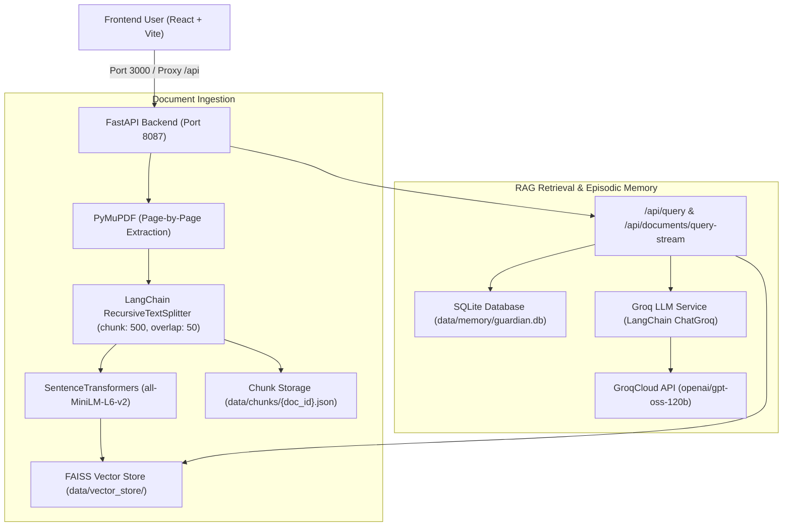

# Personal Knowledge Guardian

Personal Knowledge Guardian is a proactive AI memory system and research assistant for knowledge workers and researchers. It ingests research papers, notes, and technical documents (PDF, TXT, MD), extracts text with page-number awareness, generates dense embeddings with `sentence-transformers/all-MiniLM-L6-v2` (384-d), indexes them into a local FAISS vector store, and synthesizes grounded answers with source citations using **Groq-hosted `openai/gpt-oss-120b`** via **LangChain Groq**.

---

## 1. System Overview & Architecture



---

## 2. Prerequisites & Environment Setup

### Python Environment
- Python 3.10+ (tested with Python 3.14.2)
- Node.js 18+ and npm

### Required Python Packages
Dependencies are listed in `backend/requirements.txt`:
- `fastapi>=0.100.0`
- `uvicorn>=0.22.0`
- `pydantic-settings>=2.0.0`
- `pymupdf>=1.22.0`
- `langchain>=0.0.200`
- `langchain-groq>=1.1.0`
- `groq>=0.30.0`
- `sentence-transformers>=2.2.2`
- `faiss-cpu>=1.7.4`
- `python-dotenv>=1.0.0`
- `sqlalchemy>=2.0.0`
- `aiofiles>=23.0.0`
- `python-multipart>=0.0.6`
- `modal>=0.60.0`

Install using PowerShell:
```powershell
cd backend
.\venv\Scripts\python.exe -m pip install -r requirements.txt
```

---

## 3. Configuring Environment Variables (`backend/.env`)

Configure your environment variables in `backend/.env`.

> [!IMPORTANT]
> Never commit `.env` or share your API keys. The `.env` file is excluded from Git via `.gitignore`.

Add your Groq API credentials to `backend/.env`:

```dotenv
HOST=127.0.0.1
PORT=8087
UPLOAD_DIR=data/uploads
CHUNK_DIR=data/chunks
VECTOR_STORE_DIR=data/vector_store
MEMORY_DIR=data/memory

# Groq LLM Configuration
GROQ_API_KEY=gsk_your_actual_groq_api_key_here
GROQ_MODEL=openai/gpt-oss-120b
```

### Groq Configuration Parameters:
- **Provider**: GroqCloud
- **Model**: `openai/gpt-oss-120b` (configurable via `GROQ_MODEL`)
- **Temperature**: `0.2` (for factual, grounded responses)
- **Max Output Tokens**: `1200`
- **Max Retries**: `2` (bounded retry behavior to avoid rate-limit exhaustion)

---

## 4. Running the Application

### Start the FastAPI Backend
In PowerShell:
```powershell
cd backend
.\venv\Scripts\python.exe -m uvicorn app.main:app --host 127.0.0.1 --port 8087 --reload
```
- Swagger API Documentation: [http://127.0.0.1:8087/docs](http://127.0.0.1:8087/docs)
- Health Check: [http://127.0.0.1:8087/health](http://127.0.0.1:8087/health)

### Start the React Frontend
In a second PowerShell terminal:
```powershell
cd frontend
npm run dev
```
- Web Application: [http://localhost:3000](http://localhost:3000)

---

## 5. Testing the Groq Integration

### Automated Test Suite
Run the automated unit and integration tests (which use mocks for rate limit, authentication, and prompt construction):

```powershell
.\backend\venv\Scripts\python.exe backend/test_groq_integration.py
```

This verifies:
1. Missing or placeholder API key handling with safe user instructions.
2. Empty document retrieval and empty query handling.
3. Strict system prompt construction and `[S1]`, `[S2]` citation formatting.
4. Source metadata preservation (filename, page number, document ID, similarity).
5. Provider rate-limit (HTTP 429), auth failure (HTTP 401), and timeout handling.
6. Grounded response generation with `ChatGroq`.
7. Full compatibility with FastAPI endpoints (`/api/query`, `/api/chat/conversations`).

### End-to-End Smoke Test Flow
1. Open the web UI at `http://localhost:3000`.
2. Click **"Ingest Document"** and upload a research PDF or text file.
3. The backend extracts text with page numbers, splits into chunks, and embeds them into FAISS.
4. Switch to the **"Study Chat"** tab and ask a question about the uploaded document.
5. Groq (`openai/gpt-oss-120b`) synthesizes a grounded answer citing source passages such as `[S1]` and returns structured citations displaying the filename, page number, and similarity score.

---

## 6. Modal Cloud Deployment (Optional)

If deploying the LLM inference service to [Modal](https://modal.com):

1. **Configure Modal Secret**:
   Create a secret containing your Groq credentials (do not commit your key):
   ```powershell
   modal secret create groq-secret GROQ_API_KEY=gsk_your_actual_key GROQ_MODEL=openai/gpt-oss-120b
   ```

2. **Deploy to Modal**:
   ```powershell
   modal deploy backend/modal/deploy_llm.py
   ```
   Modal outputs a public HTTPS endpoint. Copy this URL and set it as `MODAL_ENDPOINT_URL` in `backend/.env`.

---

## 7. Troubleshooting & Common Errors

| Issue | Cause | Resolution |
| :--- | :--- | :--- |
| **"⚠️ Groq API key is not configured"** | `GROQ_API_KEY` is missing or set to placeholder in `.env` | Add your actual Groq key `GROQ_API_KEY=gsk_...` to `backend/.env` and restart the backend. |
| **"⚠️ Authentication error: Invalid Groq API key"** | The API key entered in `.env` is invalid or expired | Verify your API key on the [GroqCloud Console](https://console.groq.com/keys). |
| **"⚠️ Groq API rate limit reached (HTTP 429)"** | Groq rate limits or token per minute (TPM) limits exceeded | Wait a minute before sending requests. Groq free tier has request-per-minute (RPM) limits. |
| **"⚠️ Model access error"** | Model ID `openai/gpt-oss-120b` unavailable | Check GroqCloud supported models or set `GROQ_MODEL=llama-3.3-70b-versatile` in `.env`. |
| **"The retrieved documents do not contain enough information..."** | The user query does not match indexed passages | Upload additional documents covering the topic or rephrase the question. |

> [!NOTE]
> Groq's free tier access is subject to changing model availability, organization quotas, and rate limits. Ensure your Groq account has access to the requested model.
